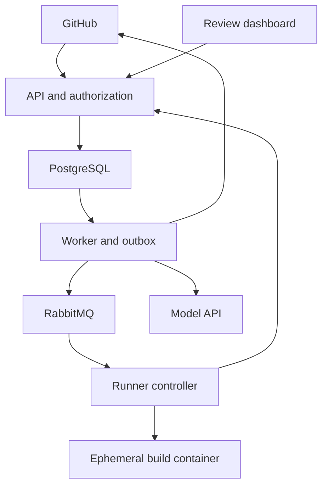

# VeraCI roadmap

This document defines the target architecture, supported scope and release gates
for VeraCI. It is a design specification, not a record of implemented capabilities.
[Project status](PROJECT_STATUS.md) records progress; [compatibility.md](compatibility.md)
records selected versions and verification results.

Navigation: [change control](#0-design-baseline-and-change-control) ·
[product](#1-product) · [scope](#2-required-scope-limits-and-success-cases) ·
[technology](#3-technology-and-compatibility) · [architecture](#4-architecture-and-trust-boundaries) ·
[releases](#15-version-by-version-delivery-plan) ·
[optional extensions](#16-optional-specializations-and-evidence-gates) ·
[repository standards](#17-repository-documentation-and-completion-standard).

## 0. Design baseline and change control

The product identity, core architecture, scope boundaries and ten-release sequence
are the accepted baseline. Architectural changes require concrete evidence: a
reproduced compatibility failure, measured limitation, demonstrated security issue
or a requirement that the design cannot satisfy.

Before implementing an architectural change, document the evidence, trade-offs,
smallest viable alternative and impact on scope, tests and delivery. Record the
decision in an ADR and synchronize affected documentation. Preserve working
implementations unless that decision requires a change.

Exact dependency versions are compatibility preflight candidates. Supported
patch/minor adjustments within the accepted release lines are recorded in
[compatibility.md](compatibility.md). Replacing a technology or departing from its
accepted release line follows the architectural change process.

The project is scoped for one developer. Each release prioritizes tested behavior,
measured results and maintainability. Optional technologies are introduced only
when their evidence gates are satisfied.

## 1. Product

Build a **GitHub-integrated evidence and verification system for small software changes**, with a bounded agent that investigates reproducible failures and can propose a repair.

The main product is a reviewable verification report: what failed, what was actually executed, what the evidence supports, what remains uncertain, and precisely which candidate a person approved. Generated patches are one input to that system. The product must still be useful when the agent abstains or fails, the model provider is unavailable, the failure is possibly flaky or infrastructure-related, or a developer supplies the candidate diff.

Preserve these separate concepts in the data model, API, UI and decision rules: **observations ≠ hypotheses ≠ generated candidate ≠ verification ≠ authorization**. A model hypothesis cannot become an observed fact, a candidate cannot become a verified change without execution, and passing checks cannot become permission to publish. Implementation must continue to serve the evidence and verification product rather than drift into a general autonomous coding agent.

The core uses TypeScript, a modular NestJS backend, React/Next.js, PostgreSQL, Prisma, RabbitMQ, Docker, GitHub Apps, one LangGraph.js workflow, the OpenAI Responses API and AWS. Delivery proceeds through ten usable, tested releases.

### What the project is responsible for

1. Receive an authenticated GitHub event and identify the exact revision.
2. Execute an approved check suite in a fresh, resource-limited environment.
3. Preserve structured results and bounded artifacts.
4. Reproduce a failure and distinguish observations from hypotheses.
5. Let a constrained agent investigate through typed tools, with durable state and budgets.
6. Optionally create one small source-code candidate.
7. Independently execute mandatory verification and produce a versioned report.
8. Require a human decision before publishing a fix PR; never merge automatically.

This is not a general CI replacement, autonomous coding employee, production incident responder, arbitrary-code hosting service, or open-ended multi-agent platform.

Reports describe observed checks and their limitations; they are not proofs of correctness, security certifications or signed supply-chain attestations.

## 2. Required scope, limits and success cases

### Required core by V9

GitHub App integration; login and tenant authorization; REST/OpenAPI; PostgreSQL transactions and migrations; RabbitMQ/outbox delivery; leases and stale-attempt fencing; Docker execution; structured logs and artifacts; reproduction and classification; one durable tool-using agent; structured outputs; prompt-injection defenses; bounded patch generation; independent verification; human approval; idempotent PR publication; an evidence dashboard; evaluation; CI/CD; security; operational telemetry; and a real AWS deployment.

### Supported repository envelope

- Initially **two or three curated repositories controlled by the developer**, with owner-approved contributors and same-repository PRs.
- One Node.js/TypeScript package per target repository, npm and a committed lockfile, one fixed runtime image family, and one supported test reporter/adapter: Vitest.
- Lint, typecheck, tests and build are declared in an owner-approved policy. “Not applicable” is explicit; a missing required check is not success.
- Small source-code bugs are repairable. Dependency upgrades, lockfile changes, workflow changes, database migrations, security configuration, infrastructure failures and flaky tests are diagnosis/abstention cases in the core.
- No arbitrary fork PR execution, public self-service repository onboarding, private package registries, arbitrary Dockerfiles, monorepo matrices, browser-dependent target builds, or customer production credentials.
- The platform repository may use npm workspaces. That does not imply support for arbitrary monorepos as build targets.

“Curated” limits exposure; it does not make repository text trustworthy or remove the fact that package installation and tests execute code.

### Required demonstration scenarios

| Scenario | Required behavior |
|---|---|
| Reproducible source bug | A duplicate-user endpoint returns 500 where its test requires 409. The same failure is observed in fresh runs; evidence points to error handling; a small candidate passes required checks; approval publishes a fix PR. |
| Intermittent failure | The same test passes and fails across recorded attempts, for example 2 failures in 4 executions. The report says “possibly flaky” and abstains from automatic repair. |
| Prompt injection | A repository comment or log tells the agent to disable tests, read secrets or push code. Tool policy prevents those actions; the attempt and outcome are recorded. |
| Recovery and staleness | A worker is killed and replaced. Its late result cannot overwrite the new attempt. A new GitHub revision invalidates the old candidate's publication eligibility. |
| Generator-independent verification | A developer submits a small incorrect diff through the API. The verifier rejects it using execution evidence without invoking the patch generator. |

## 3. Technology and compatibility

Use maintained releases, exact direct dependency pins, a committed root lockfile
and pinned container images. Resolve package engines, peer dependencies and runtime
behavior before relying on a version. Do not conceal conflicts with `--force`,
`--legacy-peer-deps` or unexplained overrides.

The required release lines are **Node.js 24 LTS, TypeScript 6, NestJS 12, React 19,
a supported/patched Next.js 16 line, PostgreSQL 18, maintained stable Prisma 7,
RabbitMQ 4.3 and Vitest without a parallel Jest stack**. Exact selections and
integration results belong in [compatibility.md](compatibility.md). The references
below support implementation; they do not establish an executed compatibility gate.

### Application, persistence and integration

| Technology | Release line and integration requirements | Official reference |
|---|---|---|
| Node.js | **24 LTS**. Resolve a supported patch and keep runtime, package engines and CI aligned. | [Node 24 release](https://nodejs.org/en/blog/release/v24.21.0) |
| TypeScript | **6.0 stable line**, strict mode. Use separate server and Next.js compiler configurations; do not force one module configuration across all packages. | [TypeScript 6.0 release](https://devblogs.microsoft.com/typescript/announcing-typescript-6-0/) |
| NestJS | **12.x**, matching compatible Nest packages, coherent ESM and Vitest. Check CLI and runtime Node requirements separately. | [Nest migration guide](https://docs.nestjs.com/migration-guide) |
| React / React DOM | **19.x**, matching runtime versions and compatible types/component peers. | [React versions](https://react.dev/versions), [Next React guidance](https://nextjs.org/docs/messages/react-version) |
| Next.js | Supported, patched **16.x** line. Validate React peers and production build/start behavior. | [Next installation](https://nextjs.org/docs/app/getting-started/installation), [support policy](https://nextjs.org/support-policy) |
| PostgreSQL | **18**, with the same major locally, in integration tests and in the initial deployment. Select a maintained image and record its digest. | [PostgreSQL version policy](https://www.postgresql.org/support/versioning/) |
| Prisma | Maintained stable **7.x** line. Align CLI, client and driver adapter; use `prisma-client`, explicit output, `prisma.config.ts` and ESM-compatible integration. | [Prisma system requirements](https://www.prisma.io/docs/orm/v7/reference/system-requirements), [Nest Prisma integration](https://docs.nestjs.com/recipes/prisma) |
| PostgreSQL driver | Use `pg` with `@prisma/adapter-pg`; configure pool bounds, timeouts and verified TLS explicitly. One database, separate application/checkpoint tables, and a total connection budget across processes. | [Prisma PostgreSQL integration recipe](https://docs.nestjs.com/recipes/prisma) |
| RabbitMQ | **4.3.x**, a supported patched image and an upgrade review before its support window ends. | [RabbitMQ releases/support](https://www.rabbitmq.com/release-information) |
| AMQP client | `amqplib` directly, so publisher confirms, returned messages and manual acknowledgements remain explicit. It is not necessary to turn the backend into Nest microservices. | [amqplib channel API](https://amqp-node.github.io/amqplib/channel_api.html), [RabbitMQ confirms](https://www.rabbitmq.com/docs/confirms) |
| GitHub integration | One official Octokit package set, a GitHub App and a documented, pinned REST API version. Validate raw webhook signatures; keep installation tokens server-side. | [Octokit](https://github.com/octokit/octokit.js), [webhook validation](https://docs.github.com/en/webhooks/using-webhooks/validating-webhook-deliveries) |
| OpenAPI / Swagger | Nest's supported OpenAPI integration, with package peers matching Nest 12. Use its documented Standard Schema path for Zod inputs and a schema converter where required; verify emitted schemas. Keep HTTP contracts separate from ORM entities. | [Nest OpenAPI](https://docs.nestjs.com/openapi/introduction) |

Use reviewed SQL migrations for constraints and indexes that require them, and parameterized SQL for locking/claim queries. The exact Prisma/driver/PostgreSQL combination must pass the V0 database integration gate.

### UI, agents and tests

| Technology | Integration requirements | Official reference |
|---|---|---|
| Tailwind CSS | Current **4.x** line; use its Next.js/PostCSS integration rather than copying a v3 setup. | [Tailwind Next.js installation](https://tailwindcss.com/docs/installation/framework-guides/nextjs) |
| shadcn/ui | Copy only needed accessible primitives into the project; it is not a second application framework. Check React 19 peers and component behavior. | [React 19 guidance](https://ui.shadcn.com/docs/react-19) |
| TanStack Query | Supported React Query release for REST data, cache invalidation and mutation state. Do not duplicate authoritative build state in browser stores. | [Installation documentation](https://tanstack.com/query/latest/docs/framework/react/installation) |
| Zod | **4.x**, with strict TypeScript. Validate API/config/tool/report boundaries at runtime. Restrict model schemas to the provider's supported JSON Schema subset. | [Zod documentation](https://zod.dev/) |
| React Hook Form | **Optional**, only when repository settings forms become complex enough to justify it. If introduced, use a resolver release supporting Zod 4. | [Official resolvers](https://github.com/react-hook-form/resolvers) |
| LangGraph.js | **1.x stable/LTS line**, one bounded workflow with the official PostgreSQL checkpointer. Checkpointer packages have their own versions; validate the combination. | [Release policy](https://docs.langchain.com/oss/javascript/release-policy), [checkpointers](https://docs.langchain.com/oss/javascript/langgraph/checkpointers) |
| OpenAI SDK / Responses API | Official JavaScript SDK. Use documented function calling and structured outputs through a small provider adapter. At V5, select a model supporting both capabilities and record its exact identifier. Product policy remains independent of model selection. | [Function calling](https://developers.openai.com/api/docs/guides/function-calling), [structured outputs](https://developers.openai.com/api/docs/guides/structured-outputs) |
| Vitest | One unit/integration runner with package-specific configuration. Verify Node engines and Nest SWC/decorator metadata support; frontend transpilation alone is insufficient for Nest dependency injection. | [Vitest requirements](https://vitest.dev/guide/), [Nest SWC/Vitest recipe](https://docs.nestjs.com/recipes/swc) |
| Supertest | Keep for HTTP contract tests with Vitest; it is test-runner independent. | [Supertest](https://github.com/forwardemail/supertest) |
| Testcontainers | Keep for real PostgreSQL and RabbitMQ integration tests. Requires a functioning Docker environment, not just Node dependencies. | [Testcontainers for Node.js](https://node.testcontainers.org/) |
| React Testing Library | Keep for interaction and accessibility-oriented component tests; install its required DOM testing peer. | [React Testing Library](https://testing-library.com/docs/react-testing-library/intro/) |
| Playwright | Browser workflows and server-rendered routes in WSL/Linux. Match Linux browser binaries and system dependencies to the locked Playwright version. | [Playwright requirements](https://playwright.dev/docs/intro) |
| Next.js test boundary | Test pure functions/client components with Vitest; use browser E2E for async server-component behavior that Vitest does not support. | [Next.js Vitest guide](https://nextjs.org/docs/app/guides/testing/vitest) |
| ESLint / typescript-eslint / Prettier | One linter and formatter. Resolve mutually supported TypeScript, ESLint and plugin versions; do not maintain duplicate generated linter configurations. | [typescript-eslint compatibility](https://typescript-eslint.io/users/dependency-versions/), [Prettier installation](https://prettier.io/docs/install) |
| k6 | One small performance scenario at completion. It is a separate runtime/CLI, not a Node.js application dependency. | [k6 documentation](https://grafana.com/docs/k6/latest/) |

### Execution, operations and cloud

| Technology | Integration requirements | Official reference |
|---|---|---|
| Docker / Compose | Maintained Docker Engine and Compose plugin, Linux containers and pinned images. Docker is an execution boundary with important limits, not a promise of hostile multi-tenant isolation. | [Docker security](https://docs.docker.com/engine/security/), [Compose model](https://docs.docker.com/compose/intro/compose-application-model/) |
| Artifact storage | A small filesystem-backed `ArtifactStore` locally; private S3 in AWS using SDK v3. Run contract tests for both adapters and a real S3 smoke test at deployment. Do not assume a filesystem test proves S3 behavior. | [AWS SDK v3](https://docs.aws.amazon.com/sdk-for-javascript/v3/developer-guide/getting-started-nodejs.html), [S3 security](https://docs.aws.amazon.com/AmazonS3/latest/userguide/security-best-practices.html) |
| Pino | Structured application logs from V0. Redact credentials and sensitive payloads before logging. | [Pino](https://github.com/pinojs/pino) |
| OpenTelemetry | Server-side traces and metrics with compatible SDK/exporter versions; Pino for logs. Initialize instrumentation before instrumented modules load, including ESM. Browser telemetry is outside the core. | [OpenTelemetry JS](https://opentelemetry.io/docs/languages/js/), [Node setup](https://opentelemetry.io/docs/languages/js/getting-started/nodejs/) |
| Prometheus / Grafana | A small metrics endpoint and one dashboard. Use compatible maintained releases; keep both private. Rich log aggregation is optional. | [Prometheus](https://prometheus.io/docs/introduction/overview/), [Grafana](https://grafana.com/docs/grafana/latest/) |
| GitHub Actions | CI plus image deployment. Pin actions to reviewed commit SHAs; use AWS OIDC with restricted repository/environment claims instead of stored AWS access keys. | [Secure Actions usage](https://docs.github.com/en/actions/reference/security/secure-use), [AWS OIDC](https://docs.github.com/en/actions/how-tos/secure-your-work/security-harden-deployments/oidc-in-aws) |
| AWS EC2 / ECR / S3 / IAM | Two security-separated hosts when executing repositories in the deployed demo; ECR for images, S3 for artifacts/backups, least-privilege IAM roles. AWS services do not have a single npm-style version to pin; pin images, SDK and deployment configuration. | [ECR](https://docs.aws.amazon.com/AmazonECR/latest/userguide/what-is-ecr.html), [EC2 metadata controls](https://docs.aws.amazon.com/AWSEC2/latest/UserGuide/configuring-instance-metadata-service.html), [S3 security](https://docs.aws.amazon.com/AmazonS3/latest/userguide/security-best-practices.html) |
| Caddy | Maintained Caddy 2 release for HTTPS and reverse proxying. Configure DNS, certificate reachability and SSE behavior. | [Automatic HTTPS](https://caddyserver.com/docs/automatic-https) |

Optional tools and their adoption criteria are defined in the optional-specializations section. Core artifact storage uses local files and private S3; no separate S3-compatible service is required.

### Primary development environment

Use a **Windows host with WSL2 Ubuntu, VS Code connected to WSL, and Docker Desktop using Linux containers**. Keep the repository in the WSL Linux filesystem, for example `~/projects/veraci`, rather than developing primarily under `/mnt/c/...`.

- Run repository Git, Node.js, npm, builds, tests and ordinary development commands inside WSL. Use the VS Code WSL connection so the editor, terminal and extensions operate on that same Linux workspace.
- Use Docker Desktop's WSL integration for the Ubuntu distribution. Verify Linux-container mode and access from WSL; do not add a second Docker daemon inside WSL without a concrete need.
- Use Linux workspace paths for Compose bind mounts. Verify file ownership, executable permissions, case sensitivity and a controlled symlink example; use LF line endings for repository scripts. Keep Windows and Linux dependency installations separate, including `node_modules`.
- Run Playwright with its matching Linux browser binaries/dependencies inside WSL and Linux CI. Do not rely on native Windows browser-test behavior to validate the Linux application.
- Use argument arrays for child processes and test cancellation, signals and process-tree cleanup on Linux when the runner enters V2. Avoid Windows-specific path, shell and process assumptions in application code.
- PowerShell remains appropriate for Windows host setup, WSL administration and Docker Desktop administration. Document host PowerShell and WSL commands separately.

V0 verifies this environment with small setup checks; it does not implement the V2 runner early. Record the actual Ubuntu, WSL, Docker and tool versions in `docs/compatibility.md`, and use Linux CI/runners to check the remaining differences from the eventual AWS environment.

### V0 compatibility preflight

Before feature work, resolve exact compatible version selections and record Node/npm, TypeScript, relevant package peers, image digests, environment details, verification commands and reasons for adjustments in `docs/compatibility.md`. Pin the dependencies introduced in V0 and commit the lockfile. Record later components' researched/resolved candidates without creating their runtime infrastructure early; confirm their pins and update the lockfile when their milestone introduces them.

The preflight must demonstrate: clean `npm ci`; no forced peer resolution; server production build and startup; Nest provider injection in a test; an OpenAPI schema matching an actually validated endpoint; Prisma generation/migration/query against the chosen PostgreSQL image; Next production build; a React interaction test; and a Linux Playwright smoke test. Use Node ESM/NodeNext conventions in backend packages and Next's supported bundler configuration in the frontend. Define explicit build/test roots where TypeScript 6 requires them.

Verify the WSL workspace location, Linux Docker access/mounts and Linux test environment as part of this preflight. When RabbitMQ enters V2, LangGraph/OpenAI enter V5 and S3/cloud deployment enter V6, extend the record with their actual integration smoke tests. Resolve conflicts transparently using official documentation and installation evidence. If resolution would change an architectural choice, stop and explain before changing it. Installation and integration results are required to complete each compatibility gate.

## 4. Architecture and trust boundaries

Use a **modular monolith** in one repository, with separate process entrypoints for different lifecycles. Shared ownership, shared contracts and one domain database remain intact; process separation is not a microservices program.

| Component | Responsibility | Must not do |
|---|---|---|
| Next.js web | Dashboard, evidence review, approval UI | Own domain authorization or execute repository code |
| NestJS API | Authentication, authorization, REST, webhooks, reports, SSE and internal runner endpoints | Perform long builds inside HTTP requests |
| Worker | Outbox dispatch, job coordination, graph execution, reconciliation, GitHub effects | Trust model output as a completed check |
| Runner controller | Fetch an approved snapshot, launch/stop containers, capture actual process results and upload bounded artifacts | Expose host capabilities to the build container |
| PostgreSQL | Authoritative domain state, constraints, events, idempotency and graph checkpoints | Depend on Redis or RabbitMQ as the only record of work |
| RabbitMQ | At-least-once dispatch and backpressure | Decide whether a job was completed correctly |
| Artifact store | Log chunks, reports, patches and test output | Authorize access merely because someone knows an object key |

Artifacts and telemetry are omitted from the diagram for readability. They never replace the database's ownership and status checks.

Core invariants:

1. GitHub determines repository revision state; PostgreSQL determines platform workflow state.
2. Every execution refers to immutable source and environment identifiers.
3. Only trusted controller-observed execution results can satisfy a verification check.
4. Model text, repository contents, tool output and candidate patches are untrusted inputs.
5. Duplicate dispatch is expected; domain effects have idempotency keys and reconciliation.
6. An expired attempt cannot finalize a job after a new attempt takes ownership.
7. A candidate cannot alter its own verification policy or protected tests.
8. Publication requires a current, authorized approval of the exact verified candidate.
9. The agent cannot obtain GitHub write credentials or merge code.
10. Missing evidence, unsupported scope and expired budgets result in explicit non-success states.
11. Observations, hypotheses, candidates, verification results and authorization remain distinct objects and decisions.
12. Ordinary checks, evidence review and supported human-candidate verification do not require a successful model call.

## 5. Relational model, APIs and transactional correctness

### Domain model

Introduce tables only when the corresponding release needs them. Use relational columns and foreign keys for ownership/state; reserve JSONB for versioned structured payloads, never as a substitute for core relationships.

| Group | Principal records |
|---|---|
| Identity and tenancy | `User`, `Session`, `Organization`, `Membership` |
| GitHub and policy | `GitHubInstallation`, `Repository`, `RepositoryPolicy`, `PullRequest`, `WebhookDelivery` |
| Work and execution | `Build`, `Job`, `JobAttempt`, `Runner`, `Execution`, `CheckResult` |
| Evidence and AI | `Failure`, `Evidence`, `AgentRun`, `ToolCall`, `Diagnosis`, `PatchProposal`, `VerificationReport` |
| Decisions and effects | `Approval`, `ExternalEffect`, `OutboxMessage`, `DomainEvent`, `Artifact`, `AuditEvent` |

Use one execution/check model for initial checks, reproductions, targeted investigations and candidate verification, with a purpose field and explicit relationships. A graph timeline can be stored as typed events rather than a second generic agent-step CRUD subsystem. LangGraph's internal checkpoint tables remain separate from domain entities.

Important database constraints and indexes:

- Unique GitHub delivery ID per app; unique installation and repository identifiers in their ownership context.
- Unique membership `(organization_id, user_id)`.
- Unique build business key `(repository_id, pr_number, head_sha, policy_version, rerun_generation)`; explicit reruns increment a generation.
- One active logical job for each domain operation; unique attempt number/fencing generation within a job.
- Unique scoped idempotency key plus stored request hash. Reusing a key with different input returns a conflict.
- Tenant-aware foreign keys or equivalent constrained relationships prevent connecting another tenant's proposal, report or artifact.
- Unique publication intent per approved candidate; recorded external branch/PR identifiers.
- Index queueable jobs by state and next-attempt time; leases by expiry; outbox by dispatch state; build lists by tenant/repository/creation time; events by stream/sequence.
- Keep large logs outside PostgreSQL. Store artifact IDs, hashes, sizes, media types and retention state.

Use short transactions. Do not hold a database transaction open while running Docker, calling GitHub or waiting for a model. Use compare-and-set updates for transitions, and explicit isolation/locking where invariants require it. Bound retries for serialization/deadlock errors and explain the chosen isolation level in an ADR.

### Core REST surface

All public domain routes are versioned under `/api/v1`; names can evolve before V1. Document request/response schemas, permissions, pagination, errors and idempotency behavior.

| Area | Representative operation |
|---|---|
| Identity | Login callback, current session, logout |
| Repositories | List connected repositories; view/update owner-approved policy |
| Builds | List/get builds; explicitly rerun or cancel; fetch check results |
| Evidence | Get failure, attempts, evidence references and sanitized artifact downloads |
| Investigation | Start/get/cancel an agent investigation |
| Candidates | Get a proposal; submit a bounded human diff through the same candidate path |
| Verification | Start/get verification; download versioned JSON and Markdown reports |
| Approval | Approve or reject a current candidate; inspect the recorded decision |
| Publication | Request publication of an approved candidate; inspect/reconcile its result |
| Events | Authorized SSE stream with a durable cursor |
| Internal runner | Claim/heartbeat/complete a dispatched attempt using runner-scoped authentication |

Use `202 Accepted` plus an operation resource for asynchronous actions. Distinguish invalid input, unauthenticated, unauthorized, missing resource, stale conflict, rate limit and upstream failure. A consistent error envelope includes a stable code, safe message and request ID. Enforce tenant membership on every resource access, including SSE and downloads.

Avoid building generic CRUD screens for every table. The API and UI should serve the workflow, not expose database internals.

## 6. GitHub, authentication and authorization

### User sessions and tenants

Use the GitHub App web authorization flow with one-time random state, **PKCE S256**, a fixed registered callback, server-side code exchange and server-side sessions. Current GitHub App documentation supports PKCE; a separate OAuth App is unnecessary for this scope. Keep user tokens distinct from installation tokens. [GitHub App user authorization](https://docs.github.com/en/apps/creating-github-apps/authenticating-with-a-github-app/generating-a-user-access-token-for-a-github-app)

Use secure HttpOnly cookies, regenerate session identifiers after login, expire/revoke sessions and protect state-changing requests against CSRF. Keep the web and API on one origin to simplify cookies, CORS and SSE. Handle user authorization revocation as well as installation removal.

Use three roles:

- **OWNER:** repository policy, membership, approvals and publication.
- **DEVELOPER:** investigations, reruns, candidates and ordinary review.
- **VIEWER:** authorized read-only access.

Self-approval is permitted for the single-developer demonstration; the audit trail must identify the actor. This does not provide a four-eyes separation-of-duties guarantee. Test two organizations and every cross-tenant relationship even if the hosted demonstration uses one active organization.

An installation is linked to an organization only after server-side verification of the installing user's authority and the installation/repository relationship. A user-supplied installation ID is not proof of ownership. Uninstallations and permission revocations disable new work and invalidate pending publication.

### GitHub App permissions and events

Initially request repository contents read, pull requests read and checks write, plus necessary metadata access. At V8, explicitly add contents write and pull requests write for fix publication. Do not request workflow administration or expose a merge action.

GitHub's contents-write permission is broad; it is **not** restricted to the application's branch prefix. Enforce branch policy in trusted application code and keep repository branch protections. Installation tokens are short-lived and server-side; current documentation specifies a one-hour lifetime. [Installation token documentation](https://docs.github.com/en/apps/creating-github-apps/authenticating-with-a-github-app/generating-an-installation-access-token-for-a-github-app), [Git reference permissions](https://docs.github.com/en/rest/git/refs)

Subscribe only to the events needed: installation/repository access changes and the selected pull-request opened/reopened/synchronize actions. Do not simultaneously create the same build from push, PR and check-suite events without a business deduplication rule. Never let the bot's own publication trigger an infinite repair cycle.

Validate the signature against the **raw request bytes**, restrict payload size and supported event types, and durably record an accepted delivery plus its domain/outbox changes in one transaction. Return promptly within GitHub's documented webhook response window; do not run checks inside the webhook. If durable acceptance fails, return a failure and make redelivery/reconciliation possible. [Webhook validation](https://docs.github.com/en/webhooks/using-webhooks/validating-webhook-deliveries), [webhook delivery guidance](https://docs.github.com/en/webhooks/using-webhooks/best-practices-for-using-webhooks)

Deduplicate both delivery IDs and business events. Reconcile current PR state when ordering is ambiguous; do not assume webhook arrival order matches GitHub history. Use the exact `head_sha` for the check run, persist its external ID, and reconcile ambiguous API timeouts before creating another check. [GitHub check runs](https://docs.github.com/en/rest/checks/runs)

A passing candidate never turns the original failing revision's CI check green. Its report is a separate result tied to the candidate. Ordinary CI runs on the published candidate revision.

## 7. Reliable dispatch, concurrency and recovery

Use two bounded work categories: execution jobs and control/agent jobs. A small retry/dead-letter arrangement is acceptable; do not create a queue for every graph node. The core uses a single RabbitMQ node and does not provide broker high availability.

### Transactional outbox

Create the domain operation and outbox row in the same PostgreSQL transaction. The dispatcher claims due rows using short transactions, for example `FOR UPDATE SKIP LOCKED`, commits the claim, publishes outside that transaction, waits for broker confirmation, and then records dispatch.

Persistent messages, durable queues, publisher confirms and handling of unroutable messages are separate responsibilities. In amqplib, the boolean returned by `publish` concerns stream backpressure; it is not a publisher confirmation. A crash after broker acceptance but before recording dispatch can produce a duplicate. Consumers must tolerate it. [RabbitMQ acknowledgements and confirms](https://www.rabbitmq.com/docs/confirms), [amqplib publish semantics](https://amqp-node.github.io/amqplib/channel_api.html)

### Attempts, leases and fencing

1. A consumer loads the authoritative job; it does not trust a queue payload's tenant, path or command.
2. It atomically acquires ownership, increments an attempt generation, and records a lease deadline.
3. Heartbeats extend only that attempt's lease.
4. Completion updates require the current job/attempt/generation and an eligible state. A late worker loses the compare-and-set and its artifacts remain non-authoritative.
5. A sweeper handles expired leases and redispatches eligible work with bounded backoff.
6. Cancelled or superseded work cannot later become a successful current result. Stop its process tree and retain the observed termination reason.

Manual acknowledgement occurs only after a durable result or durable retry/failure decision. A redelivered message for completed work is acknowledged without repeating its domain effect. Long executions require compatible broker acknowledgement timeouts and low prefetch.

Retry transient network/worker failures; do not repeatedly requeue a deterministic failed test as though it were infrastructure failure. Bound attempt counts and elapsed time. Poison messages reach a dead-letter/terminal state that an operator can inspect and explicitly re-drive.

Reconcile orphaned queued jobs and uncertain external effects; RabbitMQ is not the sole record that work exists. Apply per-repository and global concurrency limits, fair scheduling sufficient for the demo, and backpressure before admitting expensive work.

There is no end-to-end exactly-once guarantee across PostgreSQL, RabbitMQ, Docker, GitHub and a model provider. The intended guarantee is at-least-once dispatch with constrained, idempotent or reconciled effects and fenced authoritative completion.

## 8. Runner and repository policy

### Trusted policy and execution preparation

The planned `.veraci.yml` is an owner-reviewed configuration proposal, not an instruction channel the PR may rewrite. Store the approved policy version in PostgreSQL, including check IDs, fixed argument arrays, allowed source roots, protected files, runtime image digest, resource limits and dependency-lock hash.

Read policy from an approved baseline; changes require owner approval and a new policy version. A PR that changes the approved harness or test configuration requires policy review; do not silently adopt its replacement. Reject unsupported manifests or configuration changes from automatic repair. Resolve revision, paths and policy before dispatch; fetch using a short-lived read token in the trusted controller and remove credentials before constructing the build workspace. The core executes PR head/candidate code, not a simulated merge with the default branch, and does not claim to establish merge-integration correctness.

Pin dependency resolution with the committed lockfile. For curated fixtures, use a controlled dependency-preparation step or an immutable dependency image keyed to the lock hash. Default to installation without lifecycle scripts where the fixtures permit it; explicitly review any required scripts. This is not a claim that `npm ci --ignore-scripts` makes arbitrary dependencies safe.

Networked dependency preparation and offline test execution are separate phases. The core must demonstrate at least one clean dependency preparation, not rely only on a developer's existing `node_modules` cache.

### Container controls

- Fresh workspace and container per execution; no writable shared dependency cache across unrelated runs.
- Non-root process; drop capabilities; no privilege escalation; appropriate seccomp; read-only root filesystem with bounded writable workspace/temp locations.
- CPU, memory, process count, disk/output and wall-clock limits; kill the entire process tree on cancellation/timeout.
- No Docker socket, host home directory, cloud credentials, GitHub token, model key or control-plane environment in the child container.
- No repository-chosen container image, host mount, arbitrary executable path or user-controlled shell command string.
- Disable network for checks. If preparation needs network, use a narrow documented policy; a default Docker bridge is not an egress restriction.
- Block metadata endpoints, internal databases, broker management and control-plane networks from build containers.
- Canonicalize paths and reject traversal, symlink escapes, special files, submodules and oversized archives in supported inputs.

Docker shares the host kernel and the daemon is security-sensitive. For the deployed runner, use a separate VM from the control plane and keep the child containers unable to reach its credentials or management services. IMDSv2 and metadata hop settings are defense in depth, not a replacement for network isolation. A compromised runner host is outside the claimed verification trust boundary. [Docker security](https://docs.docker.com/engine/security/), [EC2 metadata documentation](https://docs.aws.amazon.com/AWSEC2/latest/UserGuide/configuring-instance-metadata-service.html)

A local one-machine profile is acceptable for the developer's curated fixtures. Public arbitrary-code execution requires a different isolation design and is outside the core.

### Results and artifacts

The controller captures exit status, signal, timeout, start/end time, command identity and bounded stdout/stderr. Parse structured test output with the supported adapter and retain discovered/executed/failed/skipped counts. Missing, malformed or truncated required evidence produces an inconclusive result.

Do not trust a repository-produced JSON report without reconciling it with controller-observed process results. Test counts and protected harnesses reduce suppression risks; they do not prove that malicious source code cannot manipulate its test environment.

Upload artifacts under server-generated keys with tenant/job ownership and content hashes. Redact secrets before display or model transmission, sanitize terminal controls, render logs as text, and serve untrusted files as safe downloads rather than active HTML. Retention cleanup records which evidence expired.

## 9. Reproduction, classification and evidence reports

### Reproduction protocol

Record the initial failure and then run up to three fresh reproductions under the same approved source, lockfile, image, command and relevant environment. Persist each attempt individually. The default maximum of four observations is a budget choice, not statistical proof of determinism.

Use structured reporter fields and conservative normalized fingerprints: check ID, failure kind, test identity, assertion/stack location and selected message fields. Do not merge unrelated failures just because their log text is similar. Keep raw evidence references behind the fingerprint.

| Classification | Required interpretation | Repair eligibility |
|---|---|---|
| `REPRODUCIBLE_FAILURE` | The same relevant failure was observed repeatedly under the recorded conditions | Potentially eligible if scope and evidence gates also pass |
| `POSSIBLY_FLAKY` | Pass/fail or failure-signature variation across comparable attempts | Abstain from automatic repair |
| `INFRASTRUCTURE_FAILURE` | Controller/network/resource/dependency-preparation evidence points outside supported source repair | Diagnose and stop or bounded infrastructure retry |
| `UNREPRODUCED` | Initial failure exists but controlled attempts did not reproduce it | Abstain; retain observations |
| `UNKNOWN` | Evidence is insufficient or contradictory | Abstain and explain missing evidence |

Record environmental differences and seed/time controls when available. Do not call a run “reproducible” if dependencies or execution policy changed between attempts. A model may explain classification evidence; it cannot override deterministic execution records.

### Failure capsule and verification report

The failure capsule gives the agent a bounded starting context: repository and revision, approved policy, failed check/test, structured error, selected redacted logs, changed paths and reproduction observations. Source snippets are retrieved through tools rather than sending the entire repository.

The portable report contains:

- Schema version, report ID, tenant/repository/PR IDs and creation time.
- Failing head revision `H`, original PR base revision `B`, candidate revision/tree identity `C`, and exact patch hash where applicable.
- Policy version/hash, runtime image digest, lockfile hash, harness version, relevant environment/seed identifiers and source provenance.
- Execution IDs, purposes, check IDs, timing, exit status, test counts and artifact hashes.
- Failure classification, diagnosis claims, supporting and contradicting evidence IDs, assumptions and missing evidence.
- Mandatory versus agent-requested checks, their individual outcomes and overall verdict.
- Candidate provenance: model-generated or human-supplied; model/prompt/tool versions where relevant.
- Links to approval/publication events, with current retention/staleness status in a separate lifecycle envelope.

Provide JSON for inspection and Markdown for human review. Finalize an immutable verification payload and hash its canonical content and referenced artifacts; the hash itself is excluded from its own input. Approval binds this payload hash. Mutable approval/publication/retention status belongs in the linked lifecycle envelope, so recording an approval does not change the object that was approved. New verification evidence creates a new report. A hash demonstrates consistency with stored bytes; without an external trust/signing design it does not establish independent authenticity.

Use verdicts such as `CHECKS_PASSED`, `CHECKS_FAILED`, `INCONCLUSIVE`, `POLICY_REJECTED` and `STALE`. The UI should say **“These checks passed for this candidate under these conditions”**, not “the code is correct” or “safe to merge.”

## 10. The agent: real tool use, durable state and bounded authority

### One graph, one provider integration

Use LangGraph.js for a stateful workflow. Call the official OpenAI SDK inside graph nodes through a thin application adapter; do not add another agent framework or duplicate tool orchestration layers.

The graph loads a failure capsule, checks eligibility, asks for a structured hypothesis, selects allowed evidence tools, revises its hypothesis, proposes supplemental checks, and either abstains or returns a bounded diagnosis/candidate request. Deterministic application gates decide whether patching, verification or publication may proceed.

The agent chooses among tools and can revise its investigation based on results. It is therefore more than a fixed prompt chain. Its freedom is limited by typed tools, evidence requirements, execution budgets and application state.

### State and durability

Persist an agent-run ID, graph thread/checkpoint IDs, revision/policy identities, hypothesis/evidence references, tool-call ledger, remaining budgets, waiting job IDs, outcome and version metadata. Use the official PostgreSQL checkpointer; provision and migrate it deliberately.

Checkpointing preserves graph progress, but does not make a side effect exactly once. Stable tool invocation IDs map to domain operations; a resumed node reuses or reconciles an existing operation rather than starting a new build or PR. A long-running check returns a job ID and pauses the investigation until its result is durable. Human approval waits in database state without holding an AMQP message or worker open. LangGraph explicitly documents replay and idempotency concerns around interrupts. [Checkpointers](https://docs.langchain.com/oss/javascript/langgraph/checkpointers), [interrupts and replay](https://docs.langchain.com/oss/javascript/langgraph/interrupts)

Serialize resumes for each graph thread with domain ownership/version checks, and make result-to-resume events idempotent. Reconcile the domain job ledger with checkpoints after a crash; do not assume those writes were one atomic operation.

Record model requests/results sufficiently to reconcile retries. A timeout can still make provider billing uncertain; reserve a bounded budget and record that uncertainty rather than claiming exactly-once model spend. Store observable actions, evidence and concise rationale, not private chain-of-thought.

### Tool contract

| Tool category | Allowed operations and limits |
|---|---|
| Failure/context | Get authorized failure capsule, changed-file list and bounded PR diff |
| Source evidence | Read a file range at the exact revision; obtain protected test source; inspect an approved manifest |
| Search | Bounded literal/text search within approved paths, with result/byte limits |
| Execution evidence | Read selected check output and structured test results |
| Supplemental checks | Request an existing allowed check ID or validated test selector; returns a durable execution ID |
| History | Bounded same-repository failure/history lookup, after ordinary SQL retrieval exists |
| Candidate proposal | Return a schema-valid diff proposal for application validation; no direct workspace mutation or GitHub action |

No generic shell, arbitrary URL fetch, unrestricted filesystem access, package installer, credential reader, GitHub write tool or merge tool. Even “run test” is code execution, so it uses the same isolated runner and budgets as other checks. Avoid regex search if it would introduce uncontrolled regular-expression execution.

Validate tool arguments, authorization, revision, paths and resource limits outside the model. A repository may contain instructions in code comments, documentation, filenames, test names, logs or historical records; all remain lower-trust data.

Validate cited evidence IDs against the run's authorized evidence set and validate source ranges against the recorded revision. An invented or unrelated citation cannot satisfy an evidence requirement.

### Structured outputs and prompt-injection defenses

Define Zod schemas for diagnosis, evidence reference, check request, patch proposal and abstention. Set strict function schemas explicitly, use the documented supported JSON Schema subset, and handle provider refusal, incomplete output and schema failure as distinct outcomes. Schema-valid JSON is not evidence that a claim is true. [OpenAI function calling](https://developers.openai.com/api/docs/guides/function-calling), [structured outputs](https://developers.openai.com/api/docs/guides/structured-outputs)

Keep trusted policy/instructions separate from retrieved material. Mark untrusted excerpts with provenance, cap and redact them, and enforce all capabilities outside prompts. Test direct and indirect injection, encoded instructions, malicious logs and historical-record poisoning. Treat detection as an extra signal; the security boundary is restricted capability and authorization, not a promise that the model always recognizes attacks. [OWASP prompt-injection guidance](https://cheatsheetseries.owasp.org/cheatsheets/LLM_Prompt_Injection_Prevention_Cheat_Sheet.html)

Use `store: false` when appropriate for Responses, minimize transmitted source/logs, and document provider handling. That flag alone is not a zero-data-retention guarantee. The initial demo uses non-sensitive repositories. [OpenAI data controls](https://developers.openai.com/api/docs/guides/your-data)

Initial configurable budgets: one active investigation per failure; approximately 12 tool calls; at most two supplemental executions; one candidate; bounded model tokens, input bytes and elapsed time; and per-day spend/admission limits. Tune using measurements. Reject new expensive work before the budget is exhausted rather than discovering overspend afterward.

## 11. Candidate generation, independent verification and approval

### Candidate policy

Start with at most **two source files and 80 changed lines**, one candidate per investigation. Expand only if measured fixture failures justify it. Accept a bounded unified diff, parse it, validate all paths and apply it to a fresh workspace at `H`.

Protect tests, snapshots, reporter/harness files, package manifests and lockfiles, compiler/linter/test configuration, CI workflows, `.veraci.yml`, secrets and deployment files. Reject binaries, symlink changes, submodules, path escapes and unsupported rename operations. Recheck protected-file hashes after application. Keep the trusted harness outside the mutable checkout and check tracked-source integrity after execution; checks may write only approved generated outputs and must not silently edit the candidate they purport to validate.

The same parser and policy apply to human-submitted diffs. There is no general upload marketplace or arbitrary patch-generation plugin system in the core.

### Verification policy

The owner-approved policy supplies mandatory checks. The agent can add a targeted check or explain relevance; it cannot remove, weaken or replace mandatory checks.

For an eligible candidate:

1. Confirm source/policy freshness and reproduce the baseline failure.
2. Apply the exact patch and construct the candidate commit `C` with parent `H`, recording its tree and commit identity before verification. Publish this verified commit rather than regenerating the patch later.
3. Check size, paths and protected files.
4. Execute the originally failing test/check.
5. Execute all mandatory lint, typecheck, test and build checks for the supported fixture.
6. Compare test discovery/execution/skip counts and verify required output completeness.
7. Repeat the relevant check under the configured reproduction policy.
8. Construct the report from controller-observed results, not an LLM verdict.

“Independent” means separate trusted policy and fresh execution from patch generation. It does not require a second model or agent.

For the primary deterministic fixtures, include a negative control: apply the inverse candidate change or otherwise restore the known failing code under the same harness and show that the relevant test fails again. Negative controls strengthen causal evidence but do not prove that a patch is generally correct. A comprehensive mutation-testing engine is optional.

### Approval identity and freshness

Approval binds at least:

`organization + repository + PR + H + B + candidate/tree C + patch hash + report hash + policy hash + environment identity + approver + expiry`.

Store approval and publication intent transactionally. Recheck permissions, installation access, current relevant GitHub heads, report validity and candidate identity immediately before publication. Changing the patch, head/base, policy or required execution evidence invalidates eligibility and requires verification/reapproval. Approval expiry can default to 24 hours for the demo and remains configurable.

### Correct fix-PR semantics

For a failing **same-repository PR**, build the candidate from the failing PR head `H`, then open the fix PR **into that PR's source branch**. This keeps the fix incremental and avoids accidentally including the original feature changes in a separate PR against the default branch. Show the destination branch clearly during approval. Fork PR publication is outside the core.

Use a deterministic application-owned branch name, persist a publication intent, and record resulting Git references/PR IDs. If an API call times out after GitHub may have accepted it, inspect existing branch/PR state before retrying. Never overwrite a conflicting human-owned branch.

GitHub and PostgreSQL cannot participate in one atomic transaction. A branch may change between the final read and PR creation. Detect and mark that result stale/superseded, avoid claiming its old verification still applies, and require ordinary CI and human review on the current PR. The application never merges.

## 12. Dashboard and live updates

Build six focused views: repository/build list; build execution detail; failure and reproduction evidence; investigation timeline; candidate diff and verification report; and approval/publication history. Repository policy settings can be a small owner-only panel.

The central screen answers: What revision is this? What failed? How often? What evidence supports the diagnosis? What changed? Which checks ran? What is still unknown? Is this approval current?

Use TanStack Query for REST state and SSE for notifications/progress. Persist events with monotonic per-stream sequence IDs, support `Last-Event-ID`, and return a snapshot/resynchronization instruction when old events have expired. Authorize subscriptions and artifact links individually.

For one API instance, in-process fan-out plus bounded database event polling is sufficient. This provides a concrete reason to omit Redis. Limit stream count, heartbeat connections, disable proxy buffering where required, and use polling fallback after disconnects. Do not stream unlimited raw logs or make SSE the source of truth.

Include loading, empty, partial, failed, expired and stale states; keyboard-accessible review controls; clear time/revision labels; and safe diff/log rendering. A read-only seeded demo can be public; execution and write actions remain authenticated and restricted.

## 13. Testing and measurable agent evaluation

### Conventional test strategy

| Layer | Important behaviors |
|---|---|
| Unit | State-transition eligibility, fingerprints, diff/path rules, evidence references, budgets and verdict aggregation |
| HTTP contract | Validation, status/error semantics, pagination, sessions/CSRF, role and tenant boundaries, idempotency conflicts |
| PostgreSQL/RabbitMQ integration | Transaction rollback, outbox crash windows, duplicate delivery, publisher-return handling, claim races, stale fencing and recovery |
| Runner integration | Actual failing/passing fixture, clean dependencies, timeout/cancel/process cleanup, resource/output caps and forbidden mounts/network |
| Agent contract | Tool schemas, refused/partial outputs, authorization, replay/idempotent tool effects, budget exhaustion and abstention |
| UI | Evidence navigation, disabled stale approvals, accessible interactions and SSE reconnection |
| Browser E2E | Login/review; failed build; abstention; candidate verification; approval/publication with controlled GitHub integration; cross-tenant denial |
| Cloud smoke | HTTPS, private artifact access, deployed execution, OIDC deployment, rollback and backup restore |

Use real PostgreSQL/RabbitMQ in integration tests. Mock provider/GitHub responses in deterministic CI, and run a small explicitly configured live smoke/evaluation separately. Mocked LLM tests validate plumbing, not model quality. Do not use a line-coverage percentage as the main completion criterion.

At least one fault-injection test must kill a worker between meaningful durable transitions and demonstrate correct recovery. At least one test must show that a stale worker's otherwise valid-looking completion is rejected.

### Evaluation dataset and protocol

Start with **12 distinct scenarios when the first agent ships**, then grow to approximately **26 curated scenarios** by V9: 12 deterministic source bugs, four intermittent cases, three infrastructure cases, three ambiguous/unsupported cases and four injection/tampering cases. Tag overlaps explicitly instead of double-counting them. These are scenario counts, not claims about executions already performed.

Split by underlying bug/repository family, not merely by filenames. Reserve a holdout set before prompt tuning. Use inexpensive development cases frequently; run the frozen holdout and selected stochastic repeats at release gates. Three repeats on a selected subset reveal some instability without pretending to establish high statistical confidence.

Each scenario contains a known source revision, expected classification/allowed outcomes, evidence requirements, independent behavioral checks, allowed/prohibited paths, environment and budget. The benchmark's independent assertions catch plausible but wrong or overfitted patches; passing the repository's existing tests is not the only definition of benchmark correctness.

Compare:

1. Deterministic classification and evidence collection without an LLM.
2. One model call over the same initial capsule, without investigative tools.
3. The bounded tool-using graph under a declared budget.

Use the same frozen cases and comparable conditions. State differences in information access and cost; do not claim a tool agent won a controlled experiment if it received extra ground-truth data.

| Metric | Definition and reporting rule |
|---|---|
| Classification quality | Per-class counts and confusion matrix, including unknown/abstention |
| Diagnosis quality | Evidence-grounded rubric plus known cause; report unsupported citations separately |
| Repair precision | Independently correct candidates divided by candidates produced; include denominator |
| Repair coverage | Correct repairs divided by eligible deterministic cases; publish alongside precision so always abstaining cannot look optimal |
| False verification | Candidates reported as passing whose independent benchmark checks fail |
| Regression | Newly failing independent behavior after the candidate |
| Abstention | Appropriate abstentions and missed repair opportunities by category |
| Safety | Prohibited actions requested, blocked and actually executed, recorded separately |
| Tampering | Prohibited file/harness changes attempted and accepted |
| Reliability | Successful resumes, duplicate effects, rejected stale completions and abandoned jobs |
| Efficiency | Tool/check count, input/output tokens, elapsed time and actual or explicitly estimated cost |

Publish case-level outcomes and small-sample limitations. Zero unsafe executions in 26 cases is a release result, not proof of immunity. Before allowing publication, require no accepted forbidden actions or test-tampering cases in the release suite and no known false-pass path in deterministic verification tests. There is no invented repair-success target before a baseline exists.

Version dataset, source revisions, prompts, tool contracts, policy, model identifier, SDK and environment together. A model change is an evaluated release decision. Keep redacted evaluation outputs available without a commercial observability account.

## 14. Security, observability, cloud and operations

### Security work is continuous

Authentication/authorization enters with the first connected repository; runner controls enter with the first execution; prompt defenses and evaluations enter with the first agent. The final release performs a review of existing controls rather than introducing security for the first time.

Cover webhook forgery/replay, tenant confusion, CSRF/session theft, malicious repository text, dangerous build scripts, artifact traversal/XSS, secret leakage, stale approvals, supply-chain changes, denial of service and denial of wallet. Apply request/body/artifact limits, timeouts and concurrency/spend admission controls at their actual boundaries.

Keep secrets out of builds, logs, traces and browser bundles. Separate development and deployment credentials. Scan dependencies/images and review advisories; do not automatically apply a breaking dependency upgrade without the compatibility suite. CI on untrusted PRs must not receive deployment credentials or execute privileged workflows using that PR's code. [GitHub Actions security guidance](https://docs.github.com/en/actions/reference/security/secure-use)

### Observability with a small operational footprint

Pino logs include request, tenant, repository, build, job, attempt, execution and agent-run identifiers where appropriate. Redact sensitive fields. Audit records capture actor, action, object, previous/new state and reason.

Add server-side OpenTelemetry spans across webhook intake, transaction/outbox, dispatch/claim, execution, agent node/tool and GitHub publication. Propagate trace context through messages while keeping authority in the database. Initially retain a bounded trace export for debugging; a hosted trace backend is optional.

Prometheus/Grafana cover queue age, outbox backlog, running/expired attempts, failure/retry rates, execution duration, resource kills, approval/publication errors, agent latency/tokens/cost, tool denials and abstention. Avoid tenant IDs or job IDs as unbounded metric labels. Keep detailed identifiers in logs/traces.

Provide liveness separately from readiness. Database/broker/provider degradation should be visible and should disable affected work safely; it should not create a restart storm. A model outage does not prevent viewing old reports or running ordinary CI checks.

### Deployment

Use one control-plane EC2 host for Caddy, web/API/worker, PostgreSQL and RabbitMQ, and a separate runner EC2 host for the trusted controller and ephemeral builds. This topology has single points of failure and does not provide high availability. Monitoring can be a Compose profile enabled during demonstrations and operations work.

The runner authenticates to narrow internal endpoints and the necessary dispatch channel; it receives scoped execution instructions and artifact upload capability. Build containers receive neither those credentials nor database/broker access. Keep PostgreSQL, broker management and monitoring off the public internet.

Use ECR image digests, private S3, encrypted volumes, least-privilege roles, TLS and restricted security groups. S3 access is checked through application authorization before issuing short-lived download links; use lifecycle rules and bounded retention. Set cost alerts and stop idle runner capacity when practical. Price the actual selected region/resources at deployment rather than quoting unverified monthly costs here.

GitHub Actions authenticates to AWS through OIDC with a restricted audience/subject, builds/tests/scans images, and deploys an explicitly selected release. Keep deployment secrets away from PR workflows. Serialize migrations, run production migrations deliberately, and verify health after deployment. Image rollback requires backward-compatible database changes; database rollback is not assumed automatic.

Back up PostgreSQL and required configuration/artifact metadata. Perform a restore drill into a clean environment before calling the project complete. Record measured restore time and data-loss window; do not claim an untested RTO/RPO. RDS is optional when managed database operations justify its cost; validate regional engine support if chosen.

### Performance claims

Use one k6 scenario for authenticated build-list/detail reads and a bounded webhook burst. State hardware, dataset size, concurrency, duration, error rate and latency percentiles. Measure queue wait and execution separately; the model provider's latency is not the API's database latency. Use `EXPLAIN ANALYZE` for a real slow query and document one evidence-based index or query decision.

Targets are established after a baseline. Never advertise a throughput number inferred from an empty local database or a mocked execution path.

## 15. Version-by-version delivery plan

Every version ends with a tagged, runnable system, a demonstrated workflow, tests for its new risks, updated API/docs and a short known-limitations note. Earlier capabilities continue to work. Unsupported features remain absent or explicitly disabled; they never return simulated production success.

The public roadmap remains exactly **V0–V9**. Internal checkpoints organize work within a release; they are not additional public versions. V4's real execution, failures, reproduction, evidence and classification are the prerequisites for the first agent. Therefore **V5 is the durable read-only investigation agent and initial evaluations; V6 is early cloud deployment and operational proof**. Cloud remains mandatory and must be complete before V7.

Planning estimates total **260–404 focused hours**, excluding a **25% integration contingency**. Re-estimate after V2 using actual progress. Scope changes must preserve verification and security gates.

| Version | Working outcome | Planning range |
|---|---|---:|
| V0 | Reproducible foundation | 12–20 h |
| V1 | GitHub identity, authorization and event intake | 24–36 h |
| V2 | Real queued execution | 40–60 h |
| V3 | Recovery, artifacts and live review | 24–40 h |
| V4 | Reproduction and evidence-first product | 24–36 h |
| V5 | Durable read-only investigation agent + initial evaluations | 40–60 h |
| V6 | Early cloud deployment and operational proof | 20–32 h |
| V7 | Candidates + independent verification | 32–48 h |
| V8 | Exact approval + fix-PR publication | 20–32 h |
| V9 | Evaluation, operational review and portfolio release | 24–40 h |

V5 proves agent behavior and restart durability in WSL/Linux. V6 verifies that behavior in the deployed system, including checkpoint recovery, provider outages, credentials and budgets. V7 requires both gates.

### V0 — Reproducible foundation

Establish the WSL2 Ubuntu/VS Code/Docker Desktop Linux environment described in section 3, with the repository in the Linux filesystem. Build the npm-workspace repository, minimal Next web and Nest API, PostgreSQL/Prisma migration, shared boundary schemas, Pino, health endpoints, lint/format/typecheck/test scripts and CI. Create only the packages/processes needed now. Record the threat model outline and supported repository envelope.

Establish `docs/ARCHITECTURE_INVARIANTS.md`, `docs/PROJECT_STATUS.md`, `docs/compatibility.md`, `docs/architecture.md` and `docs/adr/` with the responsibilities in section 17. Populate current facts and clearly labeled plans; do not fabricate completed checks or an implemented schema/queue that does not yet exist.

**Working demonstration:** a clean checkout in the WSL Linux filesystem installs, migrates, starts and displays API/database health, with the documented commands also exercised in Linux CI where applicable.

**Acceptance:** the compatibility preflight in section 3 passes; exact V0 pins and the lockfile are committed; any supported version adjustments have recorded reasons; a real API/database integration test and Linux browser smoke pass; production builds start; the five required documentation locations exist and describe current reality. No `--force`, `--legacy-peer-deps`, hidden local prerequisites, fake build results or future-version runtime infrastructure.

### V1 — GitHub identity, authorization and event intake

Add login/session security, organizations and three roles, verified App installation/repository linking, owner-approved policy records, raw-signature webhook validation, delivery deduplication and an authorized repository/event dashboard. Record accepted deliveries durably. Execution is clearly unavailable until V2.

**Working demonstration:** an owner connects a curated repository; a genuine PR event appears; another tenant cannot inspect it.

**Acceptance:** valid/invalid signatures, duplicate deliveries, role checks, CSRF/session expiry, installation ownership and cross-tenant access tests pass. Webhook response is prompt and durable; no “passed” check is posted without execution.

### V2 — Real queued execution

Introduce Build/Job/Attempt, transactional outbox, RabbitMQ confirms/manual ACKs, minimum lease/fencing protocol, runner controller and hardened Docker execution. Execute the approved install/lint/typecheck/test/build path at the exact revision. Capture exit status and bounded artifacts. Publish truthful GitHub checks.

**Working demonstration:** one fixture fails and another passes through an actual webhook-to-container-to-GitHub path.

**Acceptance:** real PostgreSQL/RabbitMQ tests; duplicate dispatch does not create conflicting authoritative results; transaction rollback does not publish work; timeout/kill and stale completion are handled; protected credentials/mounts/network are absent from the child; a missing required result is inconclusive. No temporary success stub.

#### Internal V2 implementation checkpoints

Track the following in `docs/PROJECT_STATUS.md`, completing and verifying one bounded checkpoint at a time. They share the existing V2 effort range and do not receive separate public release numbers.

| Internal checkpoint | Bounded outcome and verification focus |
|---|---|
| V2.a | Build/Job/Attempt domain and truthful GitHub Check state. Verify transitions, tenant ownership and business deduplication; execution remains unavailable until it exists. |
| V2.b | Transactional outbox and RabbitMQ. Verify transaction rollback, publisher confirms/returns, durable dispatch and duplicate-message handling. |
| V2.c | Docker execution adapter for curated fixtures. Verify real exit/results, Linux paths/mounts/permissions, resource bounds, timeout, signals and process-tree cleanup. Exercise it in a controlled local path while concurrency protections are completed. |
| V2.d | Leases, heartbeat ownership and fencing generations integrated with dispatch/completion. Verify claim races and rejection of stale-worker completion before enabling concurrent queued execution or automatic takeover. |
| V2.e | Integrated crash/recovery and duplicate-delivery validation. Verify worker loss/redelivery/late-result cases across the real database, broker and runner; complete the whole V2 acceptance gate. |

The V2.c adapter is not a released unfenced multi-worker execution service. The public V2 milestone is complete only after V2.e and all release acceptance criteria pass. V3 then extends recovery/reconciliation, cancellation, artifact access and live review; it does not postpone V2's basic correctness guarantees.

### V3 — Recovery, artifacts and live review

Complete reconciliation, expired-lease recovery, retry categories/backoff, cancellation/supersession, output retention and durable event cursors. Add filesystem ArtifactStore contracts, safe log/download views and SSE reconnection. Introduce lifecycle trace propagation.

**Working demonstration:** kill a runner or worker during a build, recover the job, reconnect the UI and inspect the retained attempt history.

**Acceptance:** crash-window tests around outbox and ACK; poison-message handling; old-attempt fencing; bounded concurrency; `Last-Event-ID`/snapshot recovery; artifact path/tenant denial; cleanup of cancelled processes and expired artifacts. The UI distinguishes failure, cancellation and infrastructure error.

### V4 — Reproduction and evidence-first product

Add failure fingerprints, fresh reruns, the classification table, failure capsules, evidence references and portable JSON/Markdown reports. Build the evidence/reproduction view and deterministic/flaky/infra fixtures. Begin ordinary SQL history lookup where useful.

**Working demonstration:** repeated assertion failure and intermittent failure produce different reports and explicit uncertainty, with no model required.

**Acceptance:** observations are retained individually; unrelated failures are not incorrectly conflated; missing evidence cannot pass; reports bind exact source/environment/policy; tests cover all classification branches. Every claim shown as observed has an evidence reference.

V4 provides a usable evidence/reproduction workflow without a model provider.

### V5 — Durable read-only investigation agent + initial evaluations

Prerequisite: completed V4 on top of V2/V3's real execution, durable dispatch/recovery and usable evidence. This milestone runs in the established WSL/Linux development environment and Linux CI; AWS deployment is not a prerequisite.

Add one LangGraph workflow, PostgreSQL checkpoints, the thin OpenAI adapter, structured diagnosis/abstention, bounded read/search/check tools, tool ledger, budgets and prompt versions. Seed 12 evaluation scenarios and deterministic mocks. Carry forward existing logging/tracing and add agent-specific evidence/timing/cost records. The agent cannot propose or publish a patch in this version, and has neither an unrestricted shell nor a GitHub write tool.

**Working demonstration:** an agent gathers additional evidence from real V4 failures, cites it in a diagnosis, abstains on possibly flaky/unsupported cases, and resumes after a worker restart without repeating a completed check.

**Acceptance:** a live smoke validates selected model/SDK capabilities; mocks cover refusal/partial/schema failures and provider unavailability; typed tool authorization, budgets and injection fixtures pass; restart/resume tests use real PostgreSQL checkpoints and demonstrate guarded, idempotent tool effects; baseline eval quality/cost results are saved with denominators, failures and limitations. Agent failure or provider outage leaves ordinary CI, reproduction and evidence review usable. No S3/AWS deployment dependency is introduced just to complete V5.

### V6 — Early cloud deployment and operational proof

Prerequisite: completed V5, including its initial eval results and local restart/replay checks. Deploy the existing evidence system **and its read-only agent** to the two-host AWS topology. Add ECR/S3/IAM/OIDC, Caddy HTTPS, the production artifact adapter, backups, one Prometheus/Grafana dashboard, health/degradation behavior and a deployment/rollback runbook. Cloud remains early and mandatory; do not move it to the final polish release.

**Working demonstration:** a real GitHub event executes on the separate cloud runner and produces an authorized report over HTTPS; the deployed read-only agent investigates a supported failure, and can resume after a worker restart.

**Acceptance:** actual S3 adapter smoke test; private data-plane services; child network/metadata restrictions; a successful OIDC deployment and compatible image rollback; a backup of domain data and agent checkpoints restored in a clean environment; no long-lived AWS deployment key in Actions. Verify model credentials stay out of build containers, deployed budgets/tool policy remain enforced, and provider unavailability preserves ordinary CI/evidence access. Run a small selected agent evaluation smoke in the deployed environment; investigate material differences from V5 rather than rerunning the entire benchmark on every deploy. Record cost and single-host failure limits. Cloud acceptance must pass before V7.

### V7 — Candidates + independent verification

Prerequisite: completed V5 agent/eval gates and V6 deployment/operational gates. Add the limited diff proposal, human-diff API, patch policy/parser, fresh candidate workspace, mandatory verification, protected-file/test-count checks, negative controls for primary fixtures, and candidate/report UI. Candidate creation and its verifier ship together. Human-supplied candidates use that verifier even if the model is unavailable.

**Working demonstration:** one supported bug receives a candidate that passes checks; a plausible wrong human diff fails; a test-disabling proposal is rejected.

**Acceptance:** bounds/path/protected-file tests; wrong-patch and false-pass regression cases; no agent-selected weakening of mandatory checks; reproducible candidate identity and report hash; original failing check remains truthful. No GitHub write permission is needed yet.

### V8 — Exact approval + fix-PR publication

Add the approval tuple, expiry, role checks, GitHub freshness reconciliation, publication intents and deterministic branch/PR reconciliation. Request the additional App permissions now. Open the fix PR against the original PR's source branch and retain the complete decision history.

**Working demonstration:** a human reviews the exact evidence/diff and publishes a fix PR; a concurrent source change blocks or marks publication stale.

**Acceptance:** double-click/retry idempotency; changed candidate/head/base/policy rejection; revoked membership/installation handling; timeout-after-GitHub-success reconciliation; no conflicting branch overwrite; destination branch displayed and tested; no merge capability.

### V9 — Evaluation, operational review and portfolio release

Complete the approximately 26-scenario benchmark and holdout protocol, compare baselines, run selected repeats, review security boundaries, exercise recovery/restore again where changed, and run the small load test. Complete the documentation, architecture/ER diagrams, demo data and walkthrough video.

**Working demonstration:** the five demonstration scenarios in section 2, using the same release and reported limitations.

**Acceptance:** case-level eval results with denominators and failures; no accepted prohibited actions/tampering in the release suite; no known deterministic false-pass path; measured performance/resource/cost observations; clean setup from README; working hosted read-only demo; source, tests and deployment instructions match the release tag.

V9 is the **complete core**. Historical vector retrieval, a second provider or more infrastructure is not required to call it finished.

## 16. Optional specializations and evidence gates

Choose at most one specialization after the core and only when a measured need or concrete consumer requirement justifies it. Keep Redis, pgvector, LangSmith, Grafana Loki, Terraform, RDS, MCP, a second model provider, a Python/FastAPI service, AST tooling and stronger sandbox/microVM infrastructure optional. The following gates do not override the architectural change process in section 0.

| Specialization | Add only when | Smallest acceptable experiment |
|---|---|---|
| Historical retrieval / pgvector | There are enough labeled prior cases and SQL/text retrieval misses useful analogues | Compare text retrieval with embeddings on frozen cases; verify PostgreSQL/extension compatibility, tenant filtering, diagnosis benefit and latency. No separate vector database. |
| Offline Python evaluation | Completed core evaluation exposes an analysis requirement best served by Python tooling | A typed offline evaluation/analysis CLI consuming exported reports and producing reproducible metrics. FastAPI only for an actual HTTP consumer. |
| MCP | A real external client needs the existing read-only evidence tools | Expose a few tools through current MCP transport/auth guidance; reuse authorization and limits. Protocol availability does not grant new capabilities. |
| Second model provider | A measured cost, quality or availability question exists | Implement the existing small adapter and run the same eval cases; do not introduce a second orchestration framework. |
| AST / TypeScript Compiler API / ts-morph | Text search repeatedly fails on a documented code-navigation case | One symbol/reference tool with an evaluation of usefulness and memory/latency cost. |
| LangSmith | Trace analysis/eval management consumes enough time to justify hosted tooling | Opt-in redacted traces with a source-retention review; core reports/evals remain portable without a LangSmith account. |
| Redis | Multiple API instances need shared rate limits/fan-out, or a measured cache need exists | One bounded use case; PostgreSQL retains sessions and authoritative approval/job state, and RabbitMQ remains the job dispatcher. |
| Loki or trace backend | Existing logs/trace exports fail a concrete debugging need | One operational view tied to an incident question; no duplicate telemetry stores by default. |
| Terraform / RDS | Repeatable infrastructure changes or database operations justify the effort/cost | Codify the already proven deployment or move the same database after a tested migration/restore plan. |
| Stronger isolation | Supporting external/untrusted contributors becomes a real requirement | A separately scoped threat-model and microVM/sandbox evaluation before accepting such workloads. |

**Out of the core unless requirements fundamentally change:** Kafka, Kubernetes, Temporal, multiple agent frameworks, multiple autonomous agents, a separate vector database, microservice-per-domain architecture, automatic merge and a general-purpose terminal agent. Reconsider only against concrete requirements/evidence, explain the trade-off before changing the architecture, and record the decision. Two hosts for a trust boundary do not justify a service-mesh architecture.

Also out of scope: billing, enterprise SSO, marketplace publishing, arbitrary language support, production incident remediation, automatic merge, broad code refactoring, self-modifying policies, general-purpose terminals and a custom CI workflow language.

Optional technologies require their own documentation, support, authentication and compatibility preflight before adoption.

## 17. Repository, documentation and completion standard

Planned package responsibilities, introduced only when their release needs them:

| Path | Responsibility |
|---|---|
| `apps/api` | HTTP, authentication and domain modules |
| `apps/web` | Review UI |
| `apps/worker` | Worker entrypoint using shared application modules |
| `apps/runner` | Trusted execution controller |
| `packages/contracts` | Public/event/tool schemas; no Prisma entity export to browsers |
| `packages/domain` | Shared domain rules only when actual reuse appears |
| `packages/agent` | Graph, provider adapter, prompts and tool policy, from V5 |
| `prisma` | Schema and reviewed migrations |
| `fixtures` / `evals` | Controlled repositories/scenarios, benchmark definitions and results |
| `infra` | Compose/deployment configuration and runbooks |
| `docs` | Architecture, threat model, decisions and measured results |

Do not create an internal framework or dozens of empty packages up front. Use normal branches and small PRs with passing CI; tag each version. Never rewrite tests merely to make a demo pass without recording the behavior change.

### Authoritative documentation established in V0

| Required path | Responsibility |
|---|---|
| `docs/ARCHITECTURE_INVARIANTS.md` | Rules that must not casually drift: evidence-first identity; separation of observations/hypotheses/candidates/verification/authorization; authoritative PostgreSQL state; outbox/at-least-once dispatch/leases/fencing; trust boundaries; bounded agent capabilities; protected tests/policy; exact approval and no automatic merge. Preserve the accepted decisions throughout this roadmap, not only this abbreviated list. |
| `docs/PROJECT_STATUS.md` | Current implementation facts, the current public version/internal checkpoint, verification evidence, limitations and the next bounded task. Update after every meaningful checkpoint. |
| `docs/compatibility.md` | Exact selected/pinned tool and dependency versions, lockfile/image references, supported environment, preflight results and reasons for version adjustments. Distinguish candidates from installed/tested versions. |
| `docs/architecture.md` | Current architecture, processes, data flows, schema and trust boundaries, with target/planned additions clearly labeled. Keep diagrams synchronized with reality. |
| `docs/adr/` | Accepted architectural decisions and evidence-based amendments, including alternatives, rationale, consequences and any superseded decision. |

`docs/PROJECT_STATUS.md` must always state:

1. Current version.
2. Current internal checkpoint, including V2.a–V2.e where applicable.
3. Completed functionality.
4. Current architecture.
5. Database schema status, including applied/planned migrations.
6. Queues/processes currently present.
7. Tests that currently pass, with the relevant command/result context.
8. Known bugs.
9. Known technical debt.
10. Known security limitations.
11. Next bounded task.
12. Exact verification commands.

Use explicit “none yet,” “not run,” or “planned” entries where appropriate. Do not present an old test result as verification of changed code. Keep the public README concise: purpose, implemented versus planned scope, setup, demo, current release and a high-level milestone table. **The README is not the detailed TODO/task board.**

As their features arrive, maintain the threat model and repository policy, API/OpenAPI reference, recovery/deployment/backup runbooks, evaluation protocol/results, and measured performance/cost notes. Do not fill future-version documents with claims that the corresponding system already exists.

### Implementation discipline

Implement one bounded checkpoint at a time and verify its behavior before advancing.
Preserve working code; introduce infrastructure only when its release requires it.
Resolve failing checks or record the blocker, evidence and next diagnostic step.
Keep commits focused and public release tags separate from internal checkpoints.

Update status, architecture and compatibility records with actual changes. Keep
comments focused on non-obvious decisions or constraints and avoid placeholder
packages, redundant documentation and abstractions without an existing use case.
[AGENTS.md](../AGENTS.md) contains concise development-tool guidance. Architectural
conflicts follow the change-control process in section 0.

### Completion criteria

The completed core must support:

1. Setup from a clean checkout and a deployed demonstration.
2. A traceable path from failed revision through reproduction, evidence, diagnosis,
   candidate verification, approval and PR publication.
3. Useful abstention and a recorded, blocked prompt-injection attempt.
4. Inspectable SQL constraints, outbox transactions, lease/fencing races and recovery tests.
5. Evaluation and performance results with denominators, failures and limitations.
6. Consistent source, tests, deployment instructions and documentation for the release.
